# Enterprise Playwright AI Skill Pack

A governed, vendor-neutral quality-engineering platform that gives AI coding agents a controlled set of Playwright and QA skills. It combines a 64-skill Agent Skills catalogue, fail-closed environment validation, Playwright fixtures and projects, knowledge retrieval, OPA and AST governance, supply-chain locking, secret-safe test execution, and auditable AI operations.

This repository is a **pack template and reference framework**, not a configured application for a particular production system. It ships with an intentionally unconfigured `.claude/qa.config.json`; Playwright and the shared configuration loader stop until a project owner approves environments, roles, and secret references.

The generated implementation guide is available in [`Enterprise_Playwright_AI_Skill_Pack__Setup_and_Implementation_Guide.html`](Enterprise_Playwright_AI_Skill_Pack__Setup_and_Implementation_Guide.html).

## Table of Contents

1. [Project Overview](#project-overview)
2. [Problems Solved](#problems-solved)
3. [Key Capabilities](#key-capabilities)
4. [Technology Stack](#technology-stack)
5. [System Architecture](#system-architecture)
6. [Folder Structure](#folder-structure)
7. [Configuration and Environment](#configuration-and-environment)
8. [Major Workflows](#major-workflows)
9. [Module Documentation](#module-documentation)
10. [Playwright and MCP Interfaces](#playwright-and-mcp-interfaces)
11. [Authentication and Authorization](#authentication-and-authorization)
12. [Data Architecture](#data-architecture)
13. [Error Handling and Logging](#error-handling-and-logging)
14. [Installation and Setup](#installation-and-setup)
15. [Running the Project](#running-the-project)
16. [Testing Strategy](#testing-strategy)
17. [CI/CD and Deployment](#cicd-and-deployment)
18. [End-to-End Data Flow](#end-to-end-data-flow)
19. [Known Limitations](#known-limitations)
20. [Troubleshooting](#troubleshooting)
21. [Contributing](#contributing)
22. [License](#license)

## Project Overview

The pack defines how an AI agent should discover requirements, select exactly one owning skill, ground decisions in repository knowledge, author Playwright tests, execute them deterministically, protect secrets, validate governance, and report evidence.

It provides two distinct execution surfaces:

- **Agent operations:** routing, repository discovery, scenario design, test authoring and healing, RAG retrieval, security scope checks, approvals, and reporting.
- **Test execution:** Playwright browser projects, API setup and assertions, accessibility checks, scoped security checks, fixture injection, and artifact scrubbing.

The repository is not an HTTP frontend or backend service. It does not contain application routes, controllers, persistent application tables, or a conventional database. The implemented HTTP surface exposed to tests is determined by the external application target configured in `.claude/qa.config.json`.

## Problems Solved

- Preventing AI agents from improvising tools or bypassing repository governance.
- Restricting tests to owner-approved, non-production hosts.
- Keeping credentials out of source code and Playwright specs.
- Producing traceable test scenarios from repository requirements and historical QA knowledge.
- Preventing prompt injection and secret leakage in retrieved context or artifacts.
- Detecting tampering in skills and pack files through SHA-256 locking.
- Making browser, API, accessibility, quarantine, and security testing architecturally reusable.
- Providing deterministic quality gates for skills, prompts, retrieval, and generated test specifications.

## Key Capabilities

- 64 narrowly scoped skill definitions under `.claude/skills/`.
- Central routing and operating rules in `AGENTS.md` and `CLAUDE.md`.
- Fail-closed QA configuration and environment validation.
- Browser matrix for Chromium, Firefox, and WebKit.
- Role-based Playwright storage state through `.auth/<role>.json`.
- Typed fixtures for page objects, modules, data factories, egress guards, and secret providers.
- Vendor-neutral adapters for CI environment variables, Vault, AWS, GCP, Azure, and 1Password.
- Secret registration and artifact scrubbing.
- Hybrid BM25/vector/knowledge-graph retrieval with reranking and context compression.
- ACL, PII redaction, injection quarantine, and memory write gates.
- AST governance, OPA policy, signed lock verification, approval attestations, and security scopes.
- RAG benchmarks, spec-quality KPIs, DeepEval, RAGAS, and OTLP telemetry.
- A signed, digest-named GitHub release model.

## Technology Stack

| Area | Technology | Purpose |
|---|---|---|
| Runtime | Node.js ES modules | Core scripts, hooks, MCP server, RAG pipeline, and Playwright tooling |
| Minimum Node | 24 | Declared in `package.json` and `.nvmrc` |
| Test framework | Playwright Test 1.65.0 | Browser, API, setup, accessibility, and scope-gated security projects |
| Language | TypeScript 5.9.3 | Typed Playwright fixtures, page objects, modules, data, and config |
| Accessibility | `@axe-core/playwright` 4.10.2 | WCAG-oriented accessibility analysis |
| Linting | ESLint 9.36.0 | General linting plus custom governance AST rules |
| Policy | Open Policy Agent/Rego | Governance policy over configuration and control records |
| Knowledge/MCP | Dependency-light Node.js JSON-RPC server | Local QA knowledge tools over stdio |
| Retrieval | BM25, local-hash or external embeddings, RRF, reranking | Source-grounded test design and impact analysis |
| Vector storage | Local store or optional Qdrant | Optional external vector persistence |
| AI gateway | OpenAI-compatible routes | Pinned model routing by data class |
| Evaluation | Python, DeepEval, RAGAS | Optional AI quality measurements |
| Telemetry | OTLP/OpenTelemetry contract | MCP/tool and LLM-operation span metadata |
| CI/CD | GitHub Actions | Integrity, test, evaluation, approval, reindex, baseline, and release jobs |
| Signing | Sigstore/Cosign | Lock, approval, and scope verification |
| Supply chain | npm lockfile, Renovate, GitHub attestations | Exact dependency and action pinning |

## System Architecture

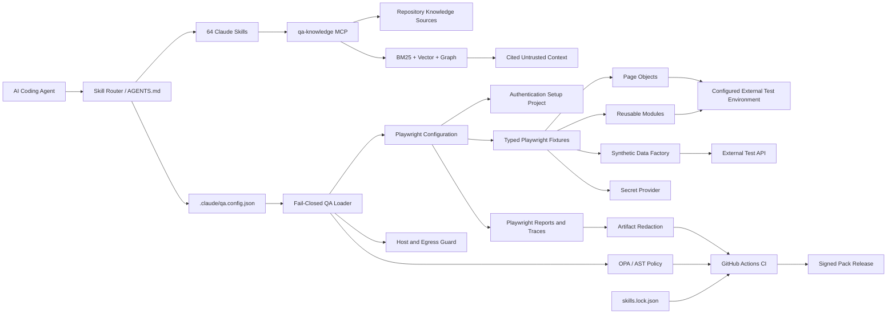

### Major architectural planes

#### 1. Agent orchestration plane

`AGENTS.md` is the host-neutral operating contract. It defines routing, safety rules, setup order, verification gates, evidence reporting, and protected actions. `CLAUDE.md` imports that contract for Claude Code.

`.claude/skills-catalog.json` adds tier, category, and default-on/off behavior. Individual skills under `.claude/skills/<name>/SKILL.md` define narrow procedures and least-privilege tool permissions.

#### 2. Configuration and security plane

`.claude/qa.config.json` is the central project state and is validated by `scripts/lib/qa-config.mjs`. The loader rejects empty project owners, missing environments, production-like hosts, invalid role references, missing secret providers, future/expired review dates, and enabled content capture.

Managed settings and hooks add a second enforcement layer for secret reads, tool permissions, MCP servers, security scope checks, and governance edits.

#### 3. Playwright test plane

`playwright.config.ts` creates setup, browser/role, quarantine, and optional security projects. The shared fixture at `src/fixtures/index.ts` injects page objects, modules, data factories, secret resolution, and browser-level host egress controls.

#### 4. Knowledge plane

The `rag/mcp/server.mjs` process exposes tools and prompts through JSON-RPC/MCP. Ingestion accepts repository sources, redacts and scans text, chunks data, builds embeddings and graphs, and stores an index locally or through a configured vector store.

#### 5. Governance and release plane

OPA, AST ESLint rules, lock verification, secret scanning, prompt scanning, attestation checks, scope checks, and CI protect the pack. The release workflow rebuilds the lock, signs it, creates a CycloneDX SBOM, attests the archive, and publishes a digest-named release.

## Folder Structure

```text
.
├── AGENTS.md                         Host-neutral agent operating contract
├── CLAUDE.md                         Claude Code import shim
├── BOOTSTRAP_PROMPT.md               Repository discovery bootstrap instructions
├── README.md                         This developer documentation
├── package.json                      npm scripts and pinned Node dependencies
├── package-lock.json                 Reproducible npm dependency lock
├── .nvmrc                            Required Node.js major version
├── tsconfig.json                     TypeScript strict and path configuration
├── playwright.config.ts              Browser, role, quarantine and security projects
├── eslint.config.mjs                 ESLint entry point
├── eslint/qa-rules.mjs               Custom Playwright governance AST rules
├── .mcp.json                         qa-knowledge and Playwright MCP servers
├── mcp.lock.json                     MCP tool/schema integrity pins
├── skills.lock.json                  SHA-256 inventory of the managed pack
├── install-manifest.json             Pack installer inclusion/scaffold rules
├── install.sh                        Pack installer entry point
│
├── .claude/
│   ├── qa.config.json                Central project/environment/role/gateway configuration
│   ├── qa.config.schema.json         JSON schema for QA configuration
│   ├── skills-catalog.json           Skill metadata, tiers, categories and defaults
│   ├── skills-manifest.json          Generated skill manifest
│   ├── skills/<name>/SKILL.md        Individual skill definitions
│   ├── memory/                       Project/team memory and staged proposals
│   ├── discovery/                    Optional repository discovery output
│   ├── rag-index/                    Local RAG index and embedding cache
│   └── telemetry/                    Optional AI Ops JSONL events
│
├── src/
│   ├── config/load.ts                Typed bridge to shared config loader
│   ├── fixtures/index.ts             Playwright test fixtures and egress guard
│   ├── fixtures/secret-providers.ts  Secret resolution adapters
│   ├── fixtures/redaction-registry.ts Artifact secret registration
│   ├── pages/home.page.ts            Home route page object
│   ├── pages/sign-in.page.ts         Sign-in route page object
│   ├── modules/sign-in.module.ts     Reusable sign-in journey
│   └── data/user.factory.ts          Synthetic API-backed test users and cleanup
│
├── tests/
│   ├── auth.setup.ts                 Role authentication/storage-state setup
│   ├── e2e/home.spec.ts              Home-page smoke coverage
│   ├── api/health.spec.ts            API health smoke coverage
│   ├── a11y/home.a11y.spec.ts        Home-page accessibility coverage
│   ├── sec/headers.spec.ts           Scoped response-hardening coverage
│   └── skills/trigger-cases.json     Skill routing evaluation cases
│
├── rag/
│   ├── cli.mjs                       RAG command-line entry point
│   ├── mcp/server.mjs                qa-knowledge JSON-RPC/MCP server
│   ├── ingestion/                    Source discovery, chunking and index construction
│   ├── orchestration/                Query planning, retrieval, scenarios and sessions
│   ├── retrieval/                    BM25/vector/RRF retrieval implementations
│   ├── rerankers/                    Lexical and external rerankers
│   ├── graph/                        Knowledge graph construction and traceability
│   ├── memory/                       Project/team memory and approvals
│   ├── security/                     Redaction, injection, ACL and output validation
│   ├── store/                        Local and optional Qdrant vector storage
│   ├── telemetry/                    OTLP and AI Ops event export
│   └── test/                         RAG and MCP Node test suite
│
├── scripts/
│   ├── verify-lock.mjs               Managed pack integrity verification
│   ├── build-lock.mjs                Lock reconstruction
│   ├── check-skills.mjs              Skill schema/catalogue/routing validation
│   ├── check-allowed-tools.mjs       Skill permission and least-privilege validation
│   ├── skill-scan.mjs                Prompt and skill security scan
│   ├── validate-config.mjs           QA configuration validator
│   ├── gen-docs.mjs                  Generated guide builder
│   ├── scrub-artifacts.mjs           Trace/report secret redaction
│   ├── secrets-scan.mjs              Secret and PII scan
│   ├── self-healing/                 Locator drift proposal and tests
│   ├── test/                         Script and hook unit tests
│   ├── lib/qa-config.mjs             Shared fail-closed config implementation
│   └── lib/files.mjs                 Lock inventory and ignored-file rules
│
├── hooks/                            Managed agent hook implementations
├── managed/                          MDM permissions and trust settings
├── policy/                           OPA Rego policy and unit tests
├── governance/                       Waivers, quarantine, approvals and scopes
├── gateway/routes.json               Model routes and data-class budgets
├── telemetry/span-contract.json      Pinned OTLP attribute contract
├── evals/                            DeepEval, RAGAS, goldens and benchmarks
├── prompts/                          Prompt templates for grounded QA work
├── docs/                             Generated guide template and assets
├── .github/workflows/                CI, release, approval, reindex and baseline jobs
└── Enterprise_Playwright_AI_Skill_Pack__Setup_and_Implementation_Guide.html
```

## Configuration and Environment

### Central configuration

The central configuration is `.claude/qa.config.json`. It contains:

- `project.name` and `project.owners`
- Named, approved `environments[].hosts`
- `defaultEnvironment`
- Explicit `productionHosts`
- Playwright framework paths, tags, roles, and fixture import
- Secret provider and role credential references
- Enabled optional skills with attestation references
- Requirements and knowledge MCP settings
- AI gateway, judge model, and token budgets
- RAG ACL, redaction, injection, encryption, and retrieval settings
- AI quality thresholds
- OTLP telemetry settings
- Memory-write policy and healing settings

### Fail-closed behavior

`validateQaConfig()` is the shared validator. It rejects:

- Missing project name or owners.
- Empty environments.
- Missing environment owner, ticket, data class, or review date.
- Invalid environment names or duplicate names.
- Bare hosts with schemes, ports, wildcards, whitespace, or placeholders.
- Production-like or explicitly blocked hosts.
- Review dates older than today or more than 90 days ahead.
- Missing or invalid framework roles.
- Unsupported secret providers.
- Missing role secret references or secret values entered as references.
- Telemetry content capture not set to `false`.
- Enabled skill entries lacking an attestation.

The shared loader throws a complete validation error list instead of falling back to a default host.

### Environment variables

| Variable | Used by | Purpose |
|---|---|---|
| `QA_ENV` | Config loader and hooks | Selects the named test environment |
| `QA_SCOPE_FILE` | Playwright and scope hook | Enables the scope-gated security project |
| `QA_RAG_PRINCIPALS` | RAG ACL | Adds principals such as `role:security` or `role:qa` |
| `QA_RAG_INDEX_KEY` | RAG encryption | Supplies an encryption key for local RAG index data |
| `QA_SKILLS_CATALOG` | Skill manifest builder | Overrides the skill catalogue path |
| `QA_REDACTION_DIR` | Redaction registry | Stores per-worker secret values outside report paths |
| `RUNNER_TEMP` | Redaction fallback | Temporary runner location used for redaction registry files |
| `QA_CANARY_SECRET` | Artifact scrubber | Registers the CI canary secret for scrubbing |
| `QA_REPO_ROOT` | QA knowledge MCP | Overrides the repository root |
| `QA_TRACE_ID` | OTLP telemetry | Correlates exported spans |
| `QA_SKILL` | OTLP telemetry | Declares the active skill name |
| `QA_SKILL_HASH` | OTLP telemetry | Declares the skill lock hash |
| `QA_DATA_CLASS` | OTLP telemetry | Declares context data classification |
| `QA_COSIGN` | Signature hooks | Overrides the Cosign executable |
| `QA_TRUST_FILE` | Installer/attestation tools | Points to the managed trust file |
| `CLAUDE_PROJECT_DIR` | Managed hooks | Supplies the repository root |
| `OTEL_EXPORTER_OTLP_ENDPOINT` | OTLP exporter | Configures the OpenTelemetry collector/endpoint |
| `OTEL_EXPORTER_OTLP_HEADERS` | OTLP exporter | Adds comma-separated OTLP headers |
| `QA_GATEWAY_TOKEN` | Model gateway operations | Authentication token, when implemented by the organization |
| `QA_GATEWAY_TOKEN_AUDIENCE` | Model gateway operations | Required gateway audience, when configured |

### Placeholder environment template

No repository `.env.example` is currently provided. A consumer-specific template should contain only variable names and non-secret placeholders:

```dotenv
# Environment selection
QA_ENV=<approved-environment-name>

# Security scope, only when a signed scope is authorized
QA_SCOPE_FILE=<relative-path-to-scope-json>

# RAG principals and optional encryption
QA_RAG_PRINCIPALS=role:qa
QA_RAG_INDEX_KEY=<organization-managed-key-reference>

# Telemetry
OTEL_EXPORTER_OTLP_ENDPOINT=<otlp-http-endpoint>
OTEL_EXPORTER_OTLP_HEADERS=<header-name>=<header-value>

# Optional model gateway
QA_GATEWAY_TOKEN=<secret-provider-value>
QA_GATEWAY_TOKEN_AUDIENCE=<gateway-audience>

# Do not place real credentials in this file.
```

The secret provider supports runtime references, not secret values, in `.claude/qa.config.json`.

## Major Workflows

### Repository bootstrap workflow

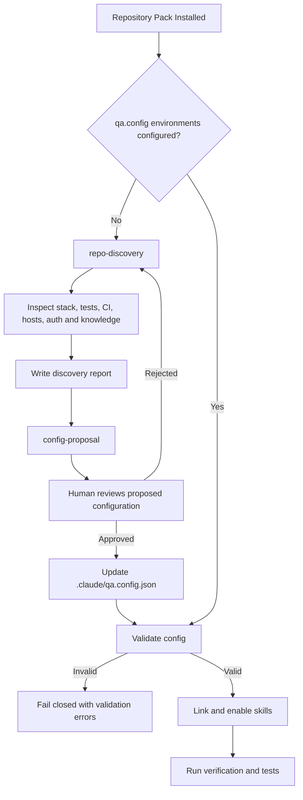

### Skill routing workflow

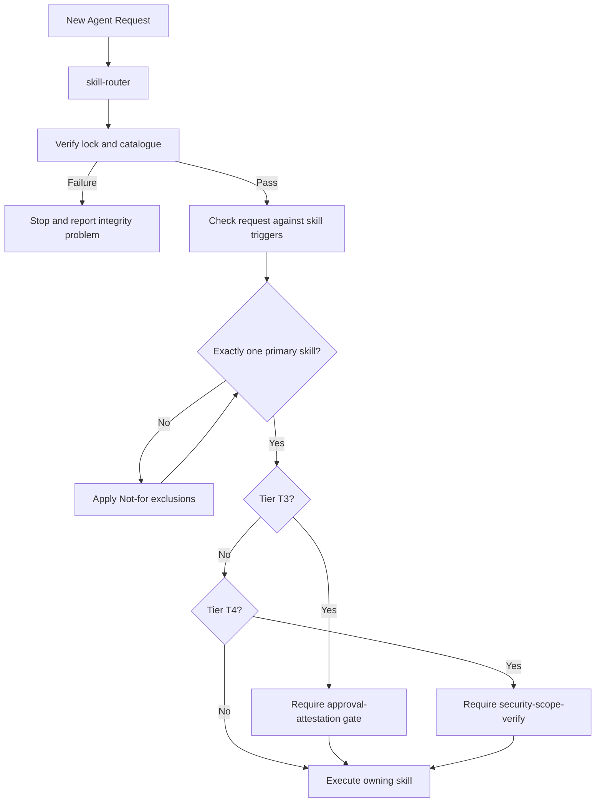

### Playwright test execution workflow

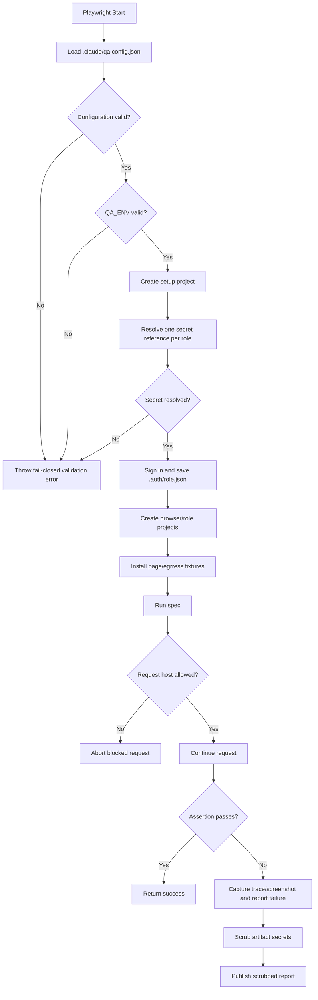

### Authentication setup workflow

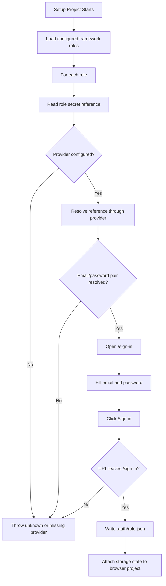

### RAG ingestion and retrieval workflow

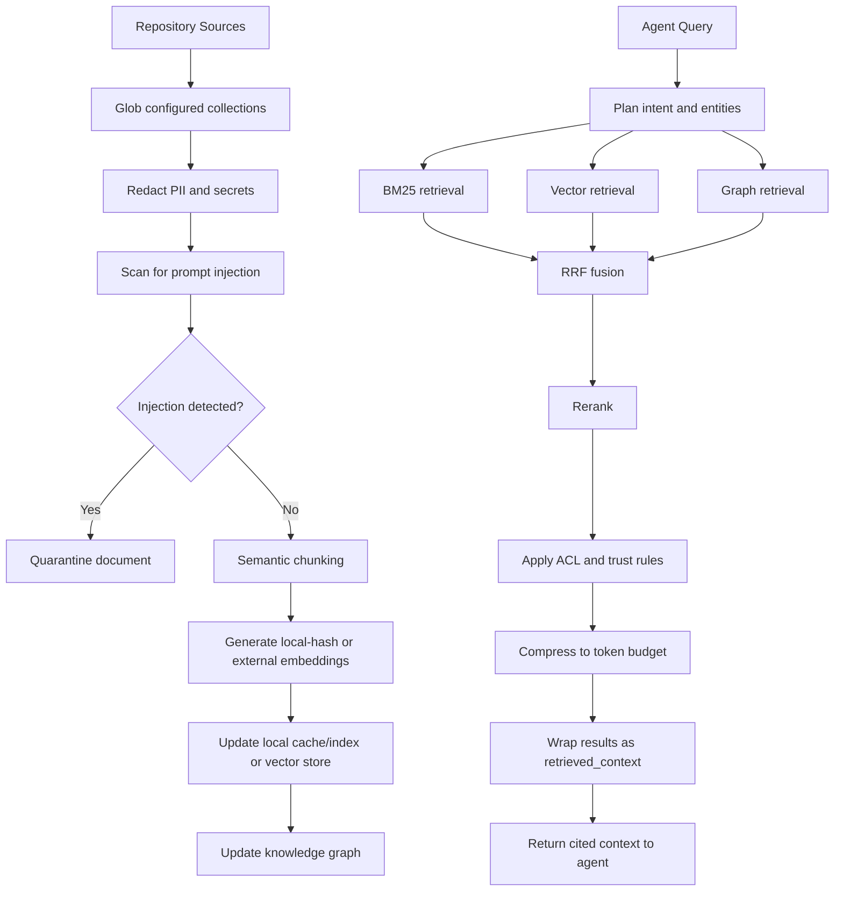

### Security scope workflow

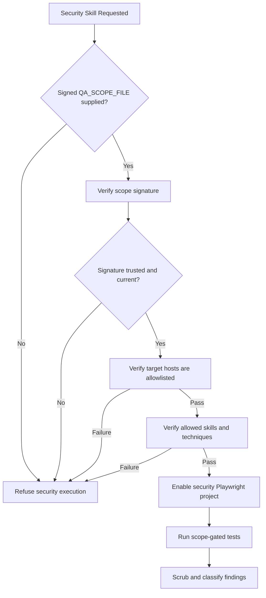

## Module Documentation

### Configuration module

- **Purpose:** Load and validate the central QA configuration once, then provide helpers to Playwright and scripts.
- **Important files:** `scripts/lib/qa-config.mjs`, `src/config/load.ts`, `.claude/qa.config.json`.
- **Important functions:** `readQaConfig`, `validateQaConfig`, `loadQaConfig`.
- **Input:** Repository root and optional `QA_ENV` environment name.
- **Output:** `LoadedQaConfig`, selected environment, base URL, and `isAllowedUrl` helper.
- **Dependencies:** Target allowlist logic in `rag/lib/targets.mjs`.
- **Communicates with:** Playwright, fixtures, hooks, OPA input, egress tools, and verification scripts.

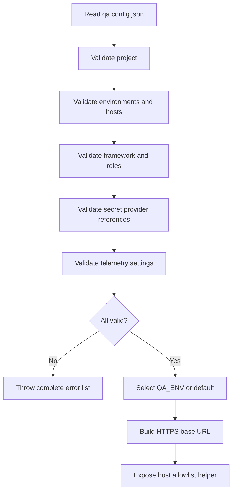

### Fixture module

- **Purpose:** Define one injected Playwright entry point for specs.
- **Important file:** `src/fixtures/index.ts`.
- **Fixtures:** `secretProvider`, `egressGuard`, `homePage`, `signInPage`, `signIn`, `users`.
- **Worker fixture:** `secretProvider` is worker-scoped.
- **Egress fixture:** Automatically aborts all network requests outside approved environment hosts.
- **Data fixture:** Creates synthetic users through `/api/test-users` and deletes created users after test completion.

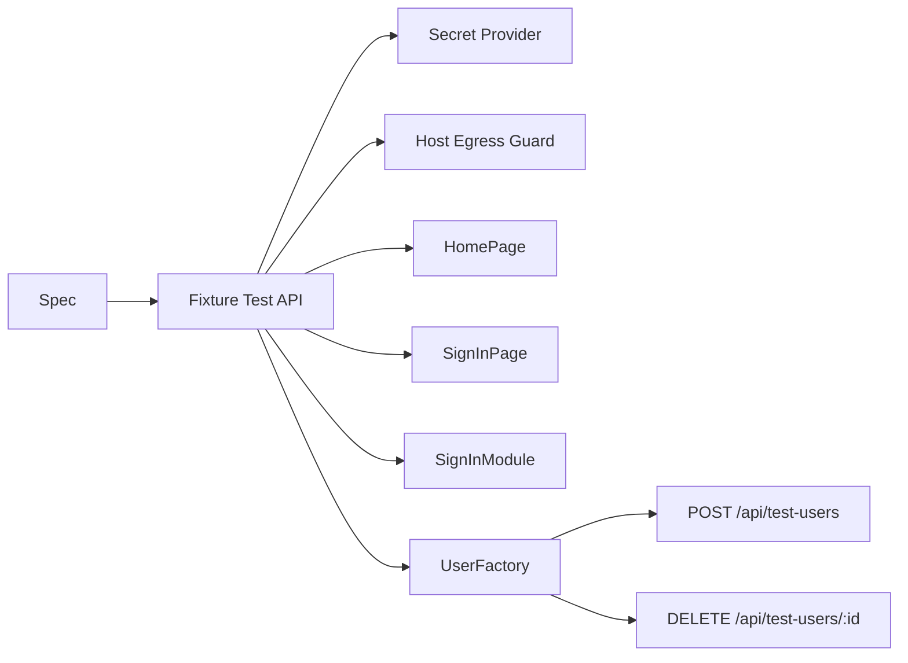

### Page-object modules

#### `HomePage`

- Route: `/`
- Responsibility: expose heading, main navigation, and sign-in link locators.
- Method: `open(): Promise<void>`.
- Assertions remain in specs, not in the page object.

#### `SignInPage`

- Route: `/sign-in`
- Responsibility: expose email, password, submit, and alert locators.
- Method: `open(): Promise<void>`.
- Assertions remain in specs or modules that return domain results.

#### `SignInModule`

- **Purpose:** Compose a sign-in flow across one page.
- **Method:** `as(email, password): Promise<void>`.
- **Steps:** open sign-in page, fill email, fill password, click submit.
- **Dependencies:** `SignInPage`.

### Secret-provider module

- **Purpose:** Resolve role credential references at runtime.
- **Provider choices:** `ci-env`, `vault`, `aws-sm`, `gcp-sm`, `azure-kv`, `1password`.
- **Input:** Provider kind and role reference names.
- **Output:** A resolved secret string.
- **Failure:** Unknown providers and missing references throw errors.
- **Security behavior:** Secrets are resolved in memory and registered for artifact scrubbing.
- **Shell handling:** External providers use `execFile`, not shell execution.

### Authentication setup module

- Iterates configured framework roles.
- Resolves `<email>:<password>` from a role secret reference.
- Opens `/sign-in`.
- Fills and submits credentials.
- Waits until the browser leaves `/sign-in`.
- Writes `.auth/<role>.json`.
- Browser projects load the matching role storage state.

### Knowledge/MCP module

The MCP server exposes tools including:

| Tool | Purpose |
|---|---|
| `rag_context` | Main hybrid retrieval context pack |
| `scenario_brief` | Requirements-based test scenario synthesis |
| `rag_search` | Direct BM25/vector/graph search |
| `plan_query` | Query-plan inspection |
| `kg_trace` | Knowledge graph traceability |
| `coverage_report` | Requirement/test/defect coverage gaps |
| `impact_analysis` | Narrow test impact selection |
| `score_spec` | Hallucination, assertion, locator, and stability scoring |
| `validate_output` | Secret/PII/injection/citation validation |
| `memory_read` | Project/team memory retrieval |
| `memory_write` | Evidence-backed staged memory proposal |
| `memory_feedback` | Retrieval document feedback |
| `index_status` | RAG index health |
| `ingest` | Incremental source ingestion |

The MCP transport is newline-delimited JSON-RPC 2.0 over stdio. It logs to stderr and keeps stdout reserved for protocol messages.

### Governance modules

- `hooks/`: deny secret reads, verify security scopes, and run post-edit governance checks.
- `policy/`: OPA input generation and Rego deny rules.
- `eslint/qa-rules.mjs`: AST rules for XPath, hard waits, network idle, page-object construction in specs, absolute URLs, credentials, tags, focused/skipped tests, and duplicate page-object ownership.
- `governance/waivers.yaml`: approved, expiring exceptions.
- `governance/quarantine.yaml`: governed flaky-test entries.
- `governance/scopes/`: signed security scope records.
- `governance/approvals/`: signed gated-action bundles.

## Playwright and MCP Interfaces

This repository is primarily a Playwright skill pack. It does not implement a public REST API server.

### Implemented Playwright HTTP interactions

| Method | Relative URL | Purpose | Response |
|---|---|---|---|
| `GET` | `/api/health` | Verify external test environment health | JSON `{ "status": "ok" }` on HTTP 200 |
| `POST` | `/api/test-users` | Create a synthetic test user | JSON `TestUser` object |
| `DELETE` | `/api/test-users/:id` | Remove a synthetic test user | No response contract asserted; status must be successful |
| `GET` | `/` | Security header check | Response headers only |

#### `GET /api/health`

```http
GET /api/health
Accept: application/json
```

```http
HTTP/1.1 200 OK
Content-Type: application/json

{"status":"ok"}
```

No authentication header is asserted in this reference test. The external target and authentication requirements must be defined by the consuming project.

#### `POST /api/test-users`

```http
POST /api/test-users
Content-Type: application/json

{
  "id": "",
  "email": "qa+<worker-uuid>@example.test",
  "displayName": "QA User <worker-uuid>"
}
```

```json
{
  "id": "generated-id",
  "email": "qa+<worker-uuid>@example.test",
  "displayName": "QA User <worker-uuid>"
}
```

The factory throws when the response is not successful and automatically deletes every returned `id` during fixture teardown.

#### `DELETE /api/test-users/:id`

```http
DELETE /api/test-users/generated-id
```

The fixture treats the response as a cleanup operation and does not create a database in this repository.

### MCP protocol

The `.mcp.json` configuration starts:

- `qa-knowledge`: `node rag/mcp/server.mjs`
- `playwright-test`: `npx --no-install playwright run-test-mcp-server`

Example MCP tool flow:

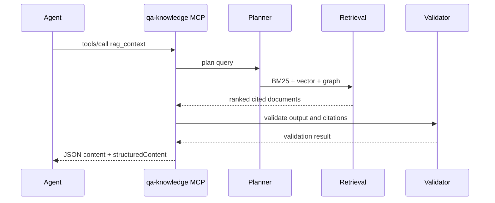

## Authentication and Authorization

### Authentication flow

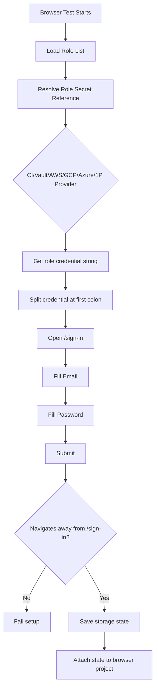

### Role-based authorization

The Playwright config creates one project per browser/role pair. Current role names come only from `.claude/qa.config.json`; the shipped file contains no roles.

Authorization behavior in this repository is implemented through:

- Role storage-state selection.
- `multi-role-auth` skill rules for UI/API allow and deny matrices.
- Scope-gated security tests.
- Host allowlisting.
- MCP ACLs from `rag.security.acl`.
- OPA evaluation for skill and governance policy.

There is no in-repository application login backend or role database. An external system must implement `/sign-in`, role sessions, logout, and API authorization.

### Protected operations

Operations such as baseline updates, quarantine changes, waivers, knowledge promotion, defect filing, and dashboard publishing require T3 approval attestations. Security testing requires a signed T4 scope.

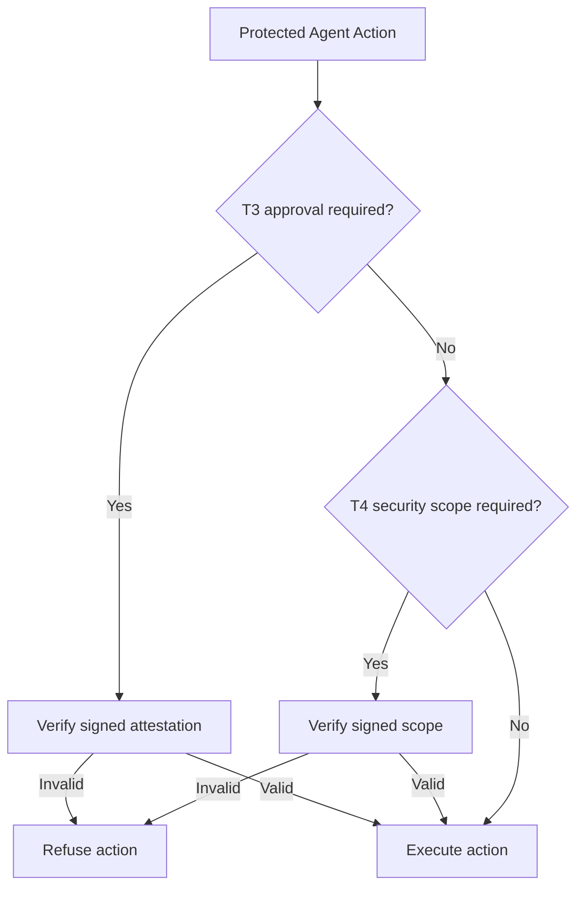

## Data Architecture

### Database status

There is **no application database, ORM, SQL schema, migration system, or data repository implementation** in this repository.

The project uses file-based state for:

| State | Location | Purpose |
|---|---|---|
| QA configuration | `.claude/qa.config.json` | Environments, roles, providers and policy |
| RAG index | `.claude/rag-index/` | Retrieved repository knowledge |
| Embedding cache | `.claude/rag-index/embedding-cache.json` | Incremental embedding reuse |
| Project memory | `.claude/memory/project/` | Project patterns, defects and decisions |
| Team memory | `.claude/memory/team/` | Shared patterns and findings |
| Staged memory | `.claude/memory/pending/` | Awaiting approval |
| Browser sessions | `.auth/<role>.json` | Role storage state |
| Reports | `reports/` | Healing proposals and generated reports |
| Playwright artifacts | `test-results/`, `blob-report/`, `playwright-report/` | Trace, blob and HTML reports |

### RAG entity relationships

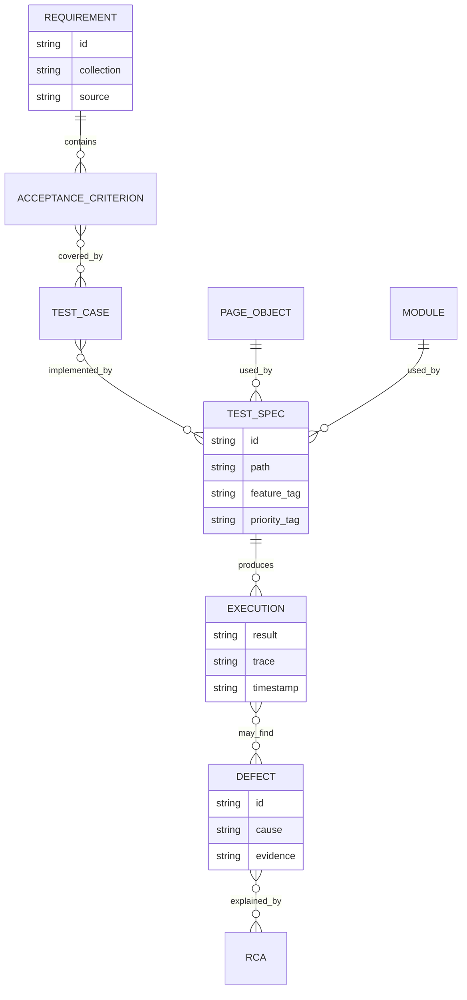

This ER model reflects RAG knowledge entities and traceability concepts in the source. It is not a database schema for a deployed application.

### Test-data flow

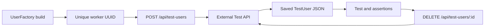

## Error Handling and Logging

### Configuration errors

The shared configuration loader returns a complete list of validation problems. Playwright startup throws when no usable configuration exists. It does not silently fall back to a default host.

### Hook errors

Managed hooks block secret reads, malformed tool input, invalid security scopes, and policy violations. The stop hook reruns pack verification and fails closed if verification does not pass.

### Test errors

- Missing secrets cause the secret fixture or setup project to throw.
- Host violations abort browser requests.
- API factory creation failures include the HTTP status.
- Playwright retains traces and screenshots on failure.
- Assertions use web-first assertions with no hard waits in recommended specs.

### RAG errors

The MCP server catches tool execution errors and returns JSON-RPC content marked `isError: true`. Retrieved text is untrusted. Output validation blocks leaks, unknown citations, echoed injections, and protected hosts.

### Artifact handling

Every resolved secret is written to a mode `0600` per-worker redaction registry outside artifact directories. `scripts/scrub-artifacts.mjs` reads all registries and removes values from Playwright traces, JSON reports, HTML reports, and HAR files.

### Logging

- MCP protocol logs go to stderr.
- AI Ops events go to `.claude/telemetry/ai-ops.jsonl` by default.
- OTLP spans carry pinned `qa.skill.*`, `qa.data_class`, and OpenTelemetry attributes.
- CI retains short-lived HTML/blob reports and requires scrubbing before upload.
- Content capture is disabled in the shipped configuration.

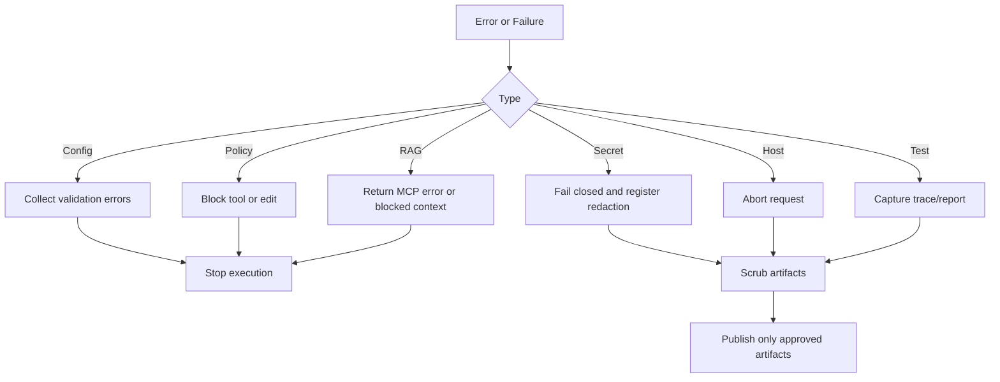

## Installation and Setup

### Prerequisites

- Node.js 24 or newer.
- npm.
- Git.
- Playwright browser binaries for local browser tests.
- Optional OPA for policy unit tests.
- Optional Cosign and signed trust configuration for releases/attestations.
- Optional organization secret-provider CLI and OIDC setup.

### Clone and install

```bash
git clone <repository-url>
cd Enterprise-Playwright-AI-Skill-Pack
npm ci --ignore-scripts
npx playwright install --with-deps
```

The repository should include `package-lock.json` for reproducible installs. If it is absent:

```bash
npm install --package-lock-only --ignore-scripts
npm ci --ignore-scripts
```

### Configure the repository

1. Bootstrap discovery using `BOOTSTRAP_PROMPT.md` or repository discovery procedures.
2. Populate `.claude/qa.config.json` through `config-proposal` and human review.
3. Add approved environment hosts only; never add production or placeholder hosts.
4. Add framework roles and secret references.
5. Configure the secret provider and CI OIDC identity.
6. Validate:

```bash
node scripts/validate-config.mjs
```

### Link agent skills

```bash
node scripts/link-skills.mjs
```

This enables default skills plus optional skills with a matching enabled attestation.

### Initialize RAG knowledge

```bash
node rag/cli.mjs ingest
node rag/cli.mjs status
```

### Build generated documentation

```bash
node scripts/gen-docs.mjs
node scripts/gen-docs.mjs --check
```

### Install into another repository

```bash
./install.sh ../target-repository
./install.sh ../target-repository --apply
```

Review the generated `.skill-pack.patch` before applying. The installer verifies signatures and hashes and does not overwrite existing Claude settings or existing repository scaffold files.

## Running the Project

### Discover tests

```bash
npx playwright test --list
```

### Run all configured tests

```bash
QA_ENV=<approved-environment-name> npx playwright test
```

### Run a browser/role project

```bash
QA_ENV=<approved-environment-name> \
npx playwright test --project=chromium-<role>
```

### Repeat a test three times

```bash
npx playwright test tests/e2e/home.spec.ts --repeat-each=3
```

### Run pack self-tests

```bash
npm run test:pack
```

### Run verification

```bash
npm run verify:pack
npm run verify
```

`npm run verify` includes configuration validation; it intentionally fails when `.claude/qa.config.json` is unconfigured.

## Testing Strategy

### Unit and integration tests

- `rag/test/*.test.mjs`: RAG, ACL, encryption, MCP, redaction, retrieval, graph, memory, and security behavior.
- `scripts/test/*.test.mjs`: lock, installer, hooks, gates, scrubbing, and governance behavior.
- `scripts/self-healing/heal.test.mjs`: locator drift and healing behavior.
- `policy/qa_test.rego`: OPA policy unit tests.

Run:

```bash
npm run test:pack
opa test policy/ -v
```

### Playwright tests

- `tests/e2e/`: end-to-end UI journeys.
- `tests/api/`: API request and response assertions.
- `tests/a11y/`: serious/critical Axe violations under WCAG tags.
- `tests/sec/`: scope-gated security-header checks.
- `tests/auth.setup.ts`: role storage-state setup.

### Skill routing tests

`tests/skills/trigger-cases.json` provides trigger cases for routing evaluation.

```bash
node scripts/check-skills.mjs
```

### Visual, performance, contract, and security expansion

The repository contains skills for these areas, but not a complete installed test estate. Implement them only after adding approved environments, owners, roles, secrets, contracts, and security scopes where required.

## CI/CD and Deployment

### CI pipeline

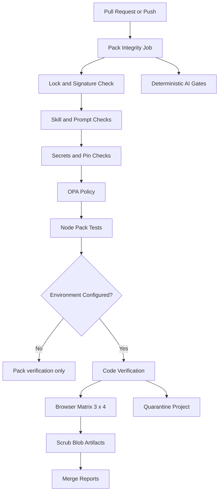

Key CI behaviors:

- Read-only default GitHub token permission.
- Hardened runner block mode.
- Lock, skill, prompt, secret, pin, OPA, config, and self-test gates.
- Chromium, Firefox, and WebKit matrix.
- Four Playwright shards.
- Quarantine project runs non-blocking.
- Blob reports are scrubbed, uploaded, and merged.
- AI evaluation gates use deterministic retrieval/spec checks plus optional Python runners.

### Deployment model

This package is distributed as a GitHub release archive rather than deployed as an application server.

The release workflow:

1. Rebuild and verify `skills.lock.json`.
2. Verify the guide is current.
3. Sign the lock with keyless Sigstore/Cosign.
4. Archive repository files.
5. Add the lock signature bundle.
6. Generate a CycloneDX SBOM.
7. Attest the archive.
8. Publish `pack-<digest12>` assets.

Managed workstation deployment requires:

- `/opt/qa-pack` owned and controlled by the platform team.
- Managed permissions and hooks installed through MDM or enterprise policy.
- `.claude` MCP servers allowed by managed settings.
- Organization trust data and secret-provider configuration.

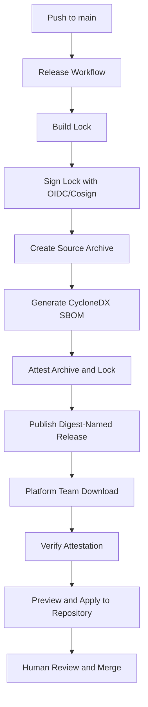

## End-to-End Data Flow

```mermaid
flowchart LR
    User[Developer or Agent] --> Host[VS Code / Claude / MCP Host]
    Host --> Contract[AGENTS.md and Skill Router]
    Contract --> Skill[Owning Skill]
    Skill --> Config[qa.config.json]
    Config --> Validator[Shared Fail-Closed Validator]

    Skill --> Query[Requirement or Ticket Text]
    Query --> MCP[qa-knowledge MCP]
    MCP --> Index[Chunked Source + Graph + Embeddings]
    Index --> Retrieval[BM25 + Vector + Graph]
    Retrieval --> Context[Cited Context]
    Context --> ValidatorOut[Output / Secret / Injection Guard]

    ValidatorOut --> Spec[Playwright Spec]
    Spec --> Fixture[Fixture Injection]
    Fixture --> Secret[Secret Provider]
    Fixture --> Page[Page Object / Module]
    Fixture --> Factory[Test Data Factory]

    Secret --> Auth[External Authentication]
    Page --> External[External Allowlisted Environment]
    Factory --> API[External Test API]

    External --> Playwright[Browser Assertions]
    API --> Playwright
    Playwright --> Report[Trace / Blob / HTML / JSON]
    Report --> Scrub[Secret and PII Scrubbing]
    Scrub --> CI[CI Artifact / Merge / Evaluation]
```

## Known Limitations

- No application database is implemented; RAG and browser sessions are file-based or external.
- The shipped QA configuration has no project, environments, roles, or secret provider.
- The MCP Playwright server is configured but the exact external server version is not locked until MCP vetting.
- Model gateway routes contain no real pinned model identifiers.
- GitHub Actions and container images intentionally require Renovate pinning before first merge.
- Python evaluation dependencies are in an input file and may require hash compilation.
- There is no implemented registration endpoint or application authentication backend.
- The reference Playwright suite is small and is a template rather than full application coverage.
- Visual, performance, mobile, broad contract, and broad authorization suites exist as skills but are not fully implemented reference specs.
- The RAG index is generated state and is excluded from the managed lock.
- No real production or test hosts are configured, as this pack must fail closed.

## Troubleshooting

### `qa.config.json is not usable`

Complete repository discovery and add:

- Project name and owners.
- At least one approved environment.
- A valid default environment.
- Framework roles.
- A supported secret provider and references.
- `telemetry.captureContent: false`.

### `Lock verification` fails

Rebuild only after intentional managed-content changes:

```bash
node scripts/build-lock.mjs
node scripts/verify-lock.mjs
```

Do not rebuild the lock to conceal unauthorized edits.

### Guide is stale

```bash
node scripts/gen-docs.mjs
node scripts/gen-docs.mjs --check
```

### Browser cannot run

```bash
npx playwright install --with-deps
npm run verify:code
```

### Playwright requests are blocked

The browser egress guard compares every URL against `environments[].hosts`. Verify that the target is explicitly listed as a bare hostname and is not production-like.

### TypeScript path alias error

This repository requires a valid TypeScript path configuration for `@fixtures`. If `baseUrl` is not configured, a non-relative path alias may fail TS5090. Keep `@fixtures` compatible with the Playwright/TypeScript bundler setup or add the appropriate local configuration intentionally.

### MCP reports no index

Run:

```bash
node rag/cli.mjs ingest
node rag/cli.mjs status
```

If encryption is enabled, set `QA_RAG_INDEX_KEY` without placing the key in source control.

## Contributing

1. Create a feature branch; do not push directly to protected `main`.
2. Route implementation through the narrowest owning skill.
3. Use data factories, page objects, modules, fixtures, and specs in that order.
4. Keep page objects assertion-free and keep journey logic reusable.
5. Never introduce secrets, production hosts, hard waits, XPath, absolute URLs, `test.only`, `test.skip`, or weakened assertions.
6. Add trigger cases when skill routing changes.
7. Rebuild the lock and guide for intentional managed-source changes.
8. Run lock checks, skill checks, self-tests, and the narrowest Playwright tests before opening a pull request.

```bash
node scripts/verify-lock.mjs
node scripts/check-skills.mjs
npm run test:pack
npm run verify:pack
```

## License

Licensed under Apache-2.0. See [`LICENSE`](LICENSE). For vulnerability reporting, follow [`SECURITY.md`](SECURITY.md).
